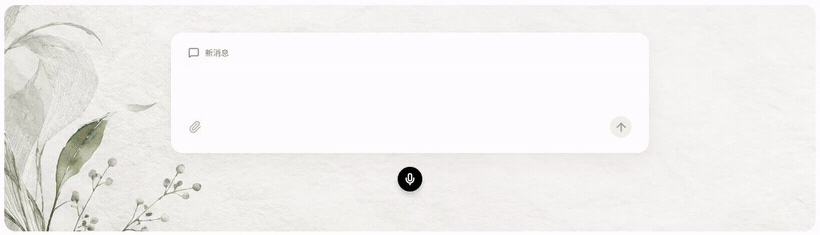
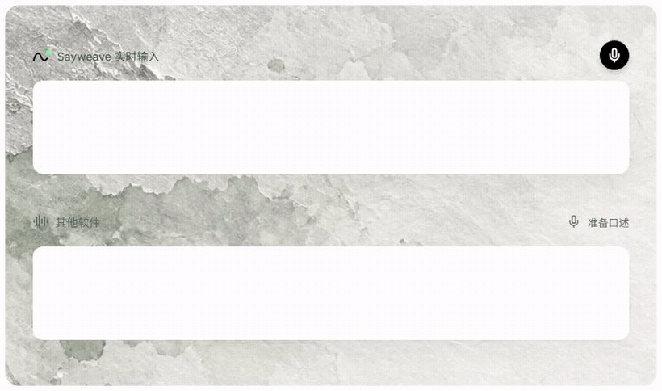
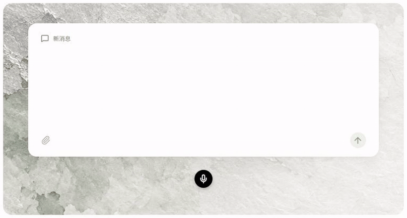
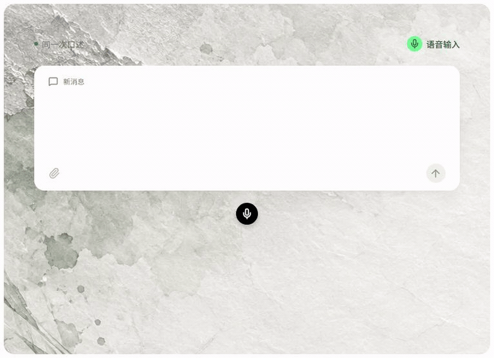
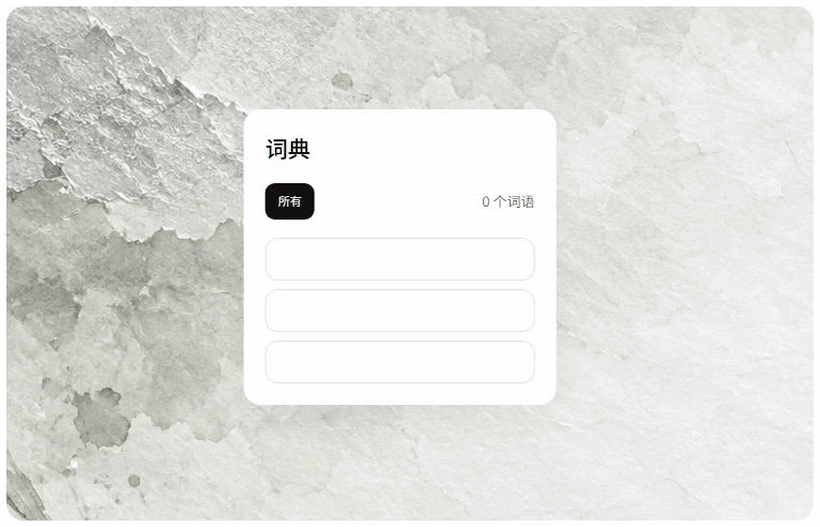
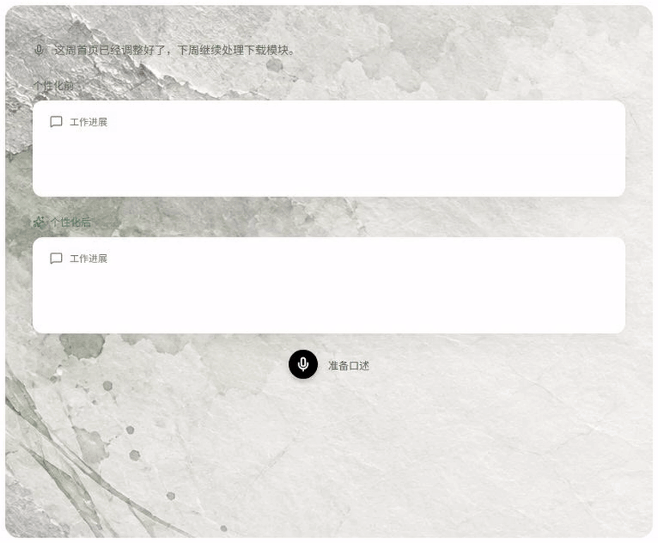
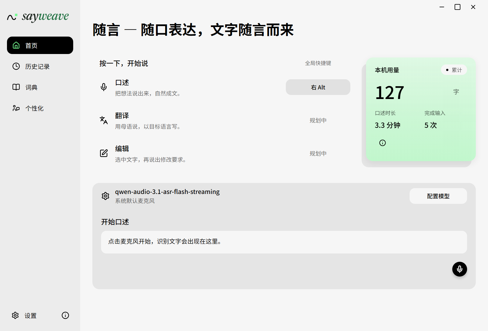
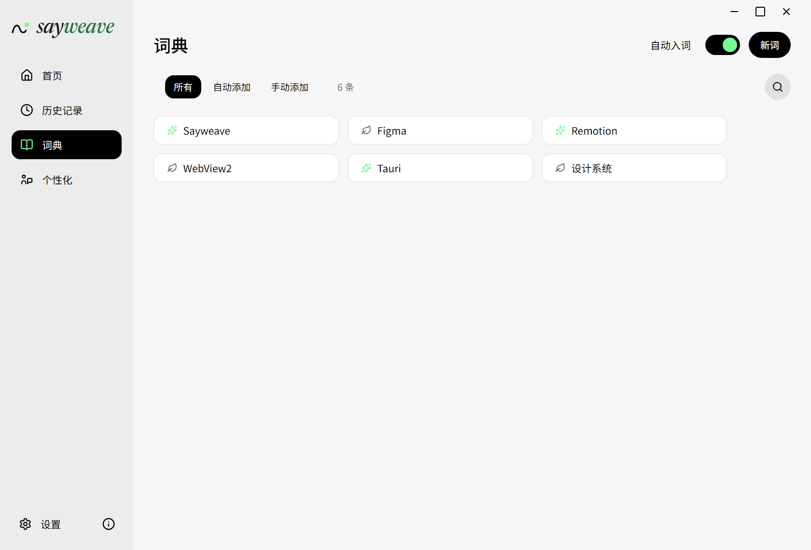
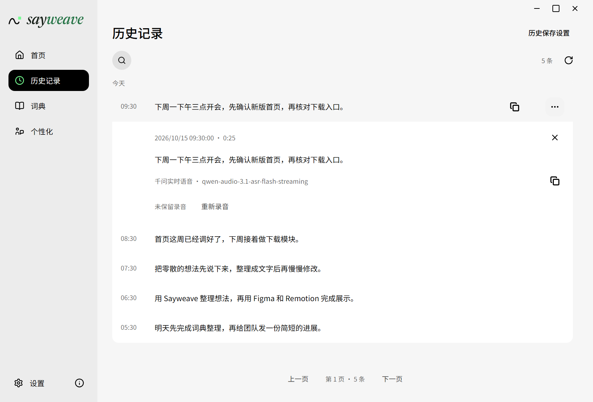
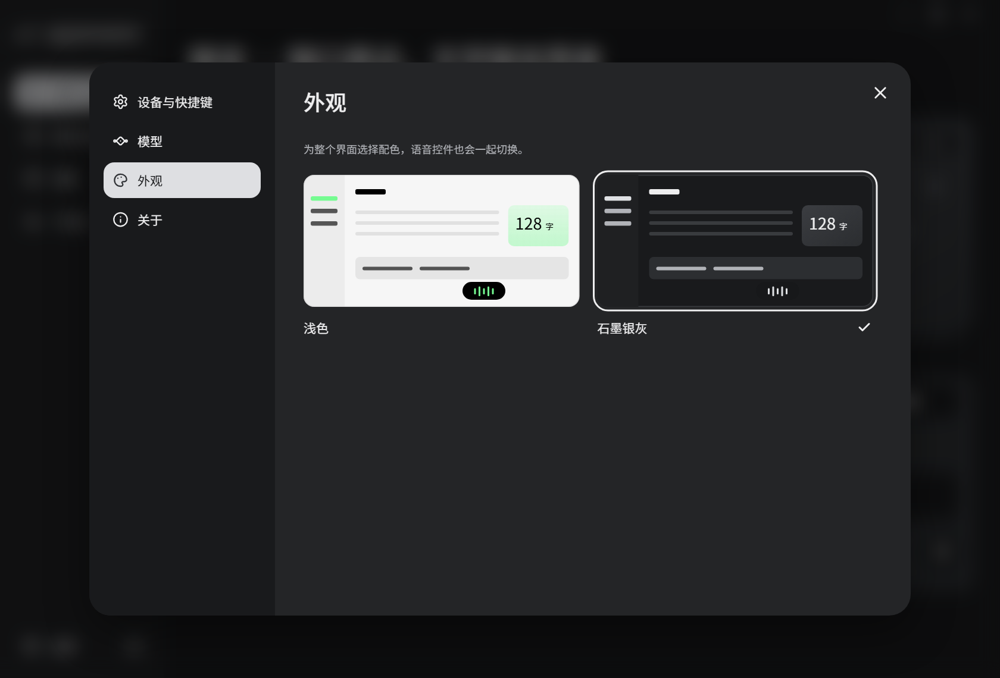

<div align="center">

<picture>
  <source media="(prefers-color-scheme: dark)" srcset="docs/images/readme/brand-dark.svg">
  <source media="(prefers-color-scheme: light)" srcset="docs/images/readme/brand-light.svg">
  
</picture>

<h1>把话说出来，<br>文字自然成稿。</h1>

开源的 Windows 语音输入工具，文字随口述出现在光标处。<br>补充、改口，或手动改几个字，都可以接着说，继续整理当前草稿。

[](https://github.com/qinghui316/Sayweave/releases/latest) [](https://github.com/qinghui316/Sayweave/releases/latest) [](LICENSE)

**[下载 Windows 版](https://github.com/qinghui316/Sayweave/releases/latest)** · **[反馈问题](https://github.com/qinghui316/Sayweave/issues)**

</div>

<p align="center"></p>

## 从开口到成稿

- **边说边看**：文字实时出现，语音控件显示录音状态和波形。
- **前后一起整理**：后续补充、明确改口可以修正当前草稿的前文。
- **键盘随时接上**：手动修改或删除块内文字后，仍能继续口述。
- **留下自己的用法**：个人词典、按应用积累的表达偏好，以及可搜索的本地历史。

整理只作用于**当前活动草稿**，输入框原有正文和已经交付的其他块不会自动纳入。

### 说到哪里，写到哪里

文字随说话逐步出现，思路也能接着往下走。

<p align="center"></p>

### 改口也能跟上

去掉语气词，把“周五发布……不对，下周一发布”整理成真正要表达的意思。文字整理需配置并开启。

<p align="center"></p>

### 打字改过，还能接着说

同一轮口述中，随手改几个字，再继续表达。

<p align="center"></p>

### 专有名词，放进自己的词典

产品名、项目名和专业词可以加入词典，作为识别热词使用；自动入词也可以单独开启。

<p align="center"></p>

### 慢慢积累自己的表达习惯

开启个性化学习后，按应用积累表达偏好，在整理时参考。

<p align="center"></p>

## 看看软件界面

### 首页

快捷键、本机用量和试说区域，打开就能找到。

<p align="center"></p>

### 个人词典

查看自动或手动添加的词条，也可以搜索、编辑。

<p align="center"></p>

### 历史记录

搜索、展开和复制口述文字；保留了录音的记录还可回放或重新识别。

<p align="center"></p>

### 浅色与石墨银灰

在外观设置中一键切换，语音控件也会使用同一套配色。

<p align="center"></p>

## 下载与开始使用

支持 **Windows x64**。从 [最新发行版](https://github.com/qinghui316/Sayweave/releases/latest) 下载 `.exe` 安装器，安装过程中可能需要管理员确认。

1. 打开 **设置 → 模型 → 语音识别**，选择服务，填写自己的 API Key 并保存。
2. 将光标放入要输入文字的输入框。
3. 按默认快捷键 **右 Alt** 开始口述，按当前录音方式结束。

需要自动整理时，在 **设置 → 模型 → 文字处理** 中配置服务，并开启“整理口述”；未开启时使用识别原文。麦克风、快捷键及“点按／按住说话”方式可在 **设置 → 设备与快捷键** 调整。

正式版可在 **设置 → 关于** 中检查、下载更新，验签完成后点击“重启并更新”。关闭主窗口会留在托盘，可从托盘重新打开或退出。

## 模型与数据

语音识别支持**千问 Qwen Audio 3.1／3.0** 和**豆包 Seed-ASR 2.0**；文字整理支持配置 OpenAI 兼容服务的地址、API Key 和模型。两种用途可以分别配置。

你需要自行提供服务凭据，费用按供应商规则计算。

- **API Key** 保存在 Windows 系统凭据中。
- **历史、词典和偏好**按各自设置保存在本机，录音是否保留由历史设置控制。
- **使用云端服务时**，相应音频或文本会发送到你配置的供应商。

详细配置见 [模型与凭据](docs/models.md)、[录音与历史](docs/speech.md)、[本地数据](docs/local-data.md)。

## 开发与文档

使用 Tauri 2、React、TypeScript 和 Rust。准备 Node.js 24、npm、Rust/MSVC、Visual Studio C++ 构建工具与 WebView2，步骤见 [开发环境](docs/development.md)。

```powershell
npm ci
npm run desktop:dev
```

`npm run dev` 是使用模拟适配器的浏览器辅助入口；源码及日常开发构建不接收正式版自动更新。

- **使用与配置**：[跨应用口述](docs/dictation.md) · [历史记录](docs/history.md) · [词典与个性化](docs/personalization.md)
- **开发与构建**：[开发说明](docs/development.md) · [Windows 发布与更新](docs/release.md)
- **架构与界面**：[模块与依赖](docs/architecture.md) · [测试方法](docs/testing.md) · [视觉规范](docs/design.md) · [交互动效](docs/motion.md)

## 反馈与许可

欢迎提交 [GitHub Issue](https://github.com/qinghui316/Sayweave/issues)。请附上 Sayweave 版本、Windows 版本、目标软件、操作步骤和实际表现；分享日志或截图前，移除密钥和私人内容。

Sayweave 采用 [Apache-2.0](LICENSE) 开源。第三方许可见 [许可目录](src/assets/licenses) 和 [NOTICE](NOTICE)。
