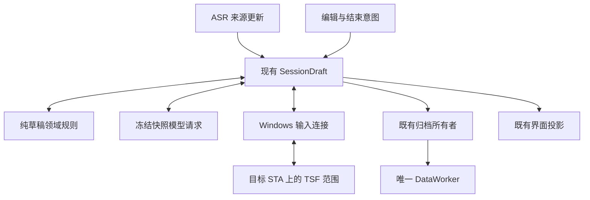

# 持续草稿与编辑接管

本文件记录已合入主线的持续草稿架构。原持续草稿候选 `e3513f2f5559d2520bc385cfbda8c95fefb6fbb0` 的验收保持原覆盖；编辑后恢复修复以 `f2ab7319f442f9e10ec5327922e812cbbf4aeb3a` 合入。此次同一 Codex 的首次改字、删除后续说和再次改字由用户确认正文与波形正常；受控宿主、实际用户反馈和原生提交确认分别留证。

现有 SessionDraft 仍是唯一串行业务调度者。`processing/draft.rs` 只维护逻辑块、来源快照、内容版本、可见版本、容量边界和停止规则，不依赖 Tauri、COM、数据库或供应商。公共来源与归档关联放在 `contracts/draft.rs`，数据层不反向依赖口述或模型模块。

逻辑块、内容快照和原生写入租约是独立身份。ASR 最终片段或停顿不交付块；模型预览替换当前草稿，并保留快照之后的新尾部。来源修订、真实编辑、停止会撤销旧结果资格。同块仅一个生成请求，沿用首次确认文字后的150ms合并窗口；结束复查实际最终覆盖，不把空请求槽当成覆盖证明。

用户编辑先撤销写权限、结束组合，再保留只读范围。原生在原 STA 核验宿主创建身份、上下文、锚点、范围版本、正文和块内选择，在原精确范围创建组合；组合对象、创建前后正文、选择及租约全部匹配才恢复 `Draft`。首次输入与重新接管统一调用组合写入，协议保留的 Apply 同样委托该实现。创建期间同步终止或重入不能发布旧候选；失败清理绑定该次创建的 epoch、上下文和监听 cookie，代次撤销不能遗漏准备资源，也不能清理新所有者。选择位置无法确定映射时，拒绝模型整块替换并保留原文；不搜索全文或猜测偏移。离开范围、Undo/Redo、文档重建和只读变化结束资格。学习观察仍是独立只读能力。

原生字符串与用户语义正文分别保存。TSF 与 UIA 各自两次读回稳定，不能证明共享正文版本。连续原生块中的内联文字可在上下文、版本、精确位置和边界账本一致时按恒等正文使用；含段落、控制字符或对象时不走这条路径，继续要求独立表示证据。块外字符从不进入该基线，不裁剪用户换行，也不根据 UIA 折叠换行、收缩范围。自有写入表示记录只解释对应操作和正文版本。块外明文不进入持久状态或日志，只保留长度和指纹。

直接 Backspace 在组合交接中可能留下比可见内联正文更长的连续跟踪范围。完整表示未获证明时，原生可以在原范围内部收缩写权限：仅保留非空内联前段作为活动范围，选择必须完全位于其中；其后的 CR/LF 单元留在编辑器中，由独立连续锚点和精确指纹保护，不判断其字符来源，不删除、重发或纳入模型基线。原块外边界保持，旧租约撤销、内容版本递增后才返回新快照。此前受保护区间继续独立核验，写入、组合结束和延迟通知均受同一保护；任何失配停止写入。这是受限范围恢复，不代表整个旧范围的语义来源已经证明。写后核验失败保留实际 Changed/Uncertain 效果，不降级为未执行并重发。

P01b 生产富文本链路已证明：组合结束后原块位置及正文未变，变化发生在严格位于块后的原生编辑范围；无需判断这些块外字符属于用户还是宿主表示，就能保持原块权限边界。首次改字、删除后继续及再次改字，均经 SessionDraft、真实 TSF 和受控模型完成前文更新，宿主事件处理后正文正确。没有通用宿主渲染完成屏障时，原生仍报告 submitted/unconfirmed；该状态不触发正文重放。实际 Codex 用户验收已通过，但不能据此把机器回执改写为 confirmed。

接管结果区分 Ready、AwaitingProof、Invalidated、Uncertain。等待消耗同一准备总期限；不确定写入停止后续正文重发。刷新租约不创建识别轮次，暂停时保留识别连接并封闭音频入口；迟到的连接就绪不能解除暂停。真实用户编辑只建立一次基线，已显示来源按片段身份和水位吸收，来源长度修订不恢复用户删除内容；无法确认部分片段分界时拒绝消费。块交付同样保存来源水位，不能把旧来源作为新尾部。

SessionDraft 每轮事件与调度完成后先更新状态投影，再发布发生变化的 Presentation。保留原识别连接恢复音频时，即使没有新的 readiness 通知，也会发布 Recording，让现有真实电平订阅恢复；暂停仍显示平线。停止和取消禁止迟到的录音状态发布，不生成模拟波形。

正文未变化的许可刷新保留原 ASR 来源和已确认预览；只有真实正文编辑才推进吸收水位。预览始终保留来源身份，不能折成用户基线。当前单一插入段无法证明纯光标移位后的来源位置时，保留原块的只读跟踪、已撤销写许可和原来源水位，在原总期限内等待真正的编辑或可证明的位置。原生有效范围不因业务来源映射暂缺而释放；真正越界和文档失效仍结束资格。真实块内改字后的新基线仍按核实的光标／选区位置接管。

首次非空 Update 在同一次原生写会话内完成写入与 Bind，文字可见时连续跟踪已经建立；回执到达前发生交接也保留返回的块身份，不恢复旧写许可。

组合范围与跟踪范围是独立对象。每次仍受授权的组合写入和换行落定完成后，原生从实际组合范围同步跟踪锚点与正文版本，不假定克隆范围会自动扩展。同步准备仍接收用户编辑；实际自身写入期间仅跳过补充跟踪的中间几何检查，原有组合所有权、焦点、撤销及清理保护继续生效。最后再次核验写权限，然后发布请求版本。失效范围不会因同步恢复资格。

临时组合文本不代表宿主持久正文。原生文档入口在存在已核验父关系时选择持续文档，让首次写入、连续跟踪和编辑后接管使用同一文档；原焦点载体及其生命周期仍是许可的一部分。共同权限与读写锁边界见 [原生文档](dictation.md#应用编辑端点与原生文档)。写入已发生而跟踪建立失败时保留真实变更效果，不能改记成未执行、发布空快照或重发。

较宽的变更通知要求原生连续锚点和当前块外 UTF16 指纹成立。只有完整枚举的原生编辑记录全部严格位于未变化块的后方，且原块两端、正文、上下文及前缀仍一致时，才能记录新的块外后缀事实，并在同一不可重入步骤撤销旧租约。范围漂移、跨界或来源不明的变化继续使权限失效。此过程不移动块端点，不扩展写入范围；重新接管仍须写锁内核验。嵌套通知不能复活失效块或提交旧证据。核验读取合计最多64Ki UTF16单元，不保留或上传块外明文。自有组合写入仍必须保持当前块外指纹；不能把自有越界写入作为外部变化采纳。

协议10增加 Bind/Read/Acquire/Apply/Release 和针对精确 operation/revision 的 Revoke。排队操作可以撤销；操作开始后以实际回执为准，不能把撤销意图当成未写入。固定代理 ABI1、控制协议1及观察版本2保持。范围、回调和清理都计入核心租约，未确认退役继续阻止不安全输入或切换。

绿色结束复用已覆盖的整理，或在原结束期限内整理最后快照；容量交付后的尾部仍须收尾。期限到后不循环读取被连续编辑赶上的快照。只有光标变化、最终来源已完整显示且没有在途整理时，绿色结束可只读保留正文，不为取得来源插入位置重新写入；有未显示尾部时继续受原期限约束。×立即停止后续应用，保留确认显示的正文。清理失败保存已知正文和不确定事实，不能宣称正常交付。

当前块上限2000 Unicode标量，前文只读参考512标量，消息32KiB，最大输出4096 tokens，正文16KiB。编辑基线占用同一块容量。句末、字素和受保护文本决定容量边界；超长不可拆片段保留原文，不发送超预算模型请求。原生容量独立限制，不截断用户正文。

schema10新增块检查点与处理尝试关联；旧 source_refs 数组、提示快照和处理记录保留。编辑器正文使用 editorSnapshot 来源，模型重写不会成为用户学习证据。历史最终正文来自实际确认版本，不拼接每次整块候选。文字整理关闭或不可用时使用 native 模式记录口述结果，不制造模型调用。恢复格式2兼容格式1；处理尝试和检查点补写完成之前不提前封存终态，取消和删除优先。恢复不执行编辑器写入。

内部 `SAYWEAVE_DRAFT_STRATEGY=segmented` 保留 schema10 兼容的旧策略及 faithful-v3 提示；用户界面没有设置项。schema10写入后不能直接交给旧程序读取。回退使用当前构建和既有部署事务，保留用户资料。

定向证据覆盖领域回放、受控供应商请求、旧历史兼容、恢复顺序，以及自有 RichEdit 的真实接管、租约失效、撤销时序和正文读回。普通 EDIT 的父文档路径、富文本和受控 HTML 输入框均已通过三轮编辑后接管与最终正文对照；同窗换到同正文的另一输入框再返回，旧资格仍被撤销。实际 Codex 的既有试用及本轮各目标宿主试用分别记录，不能由受控宿主通过推定全部兼容性。
