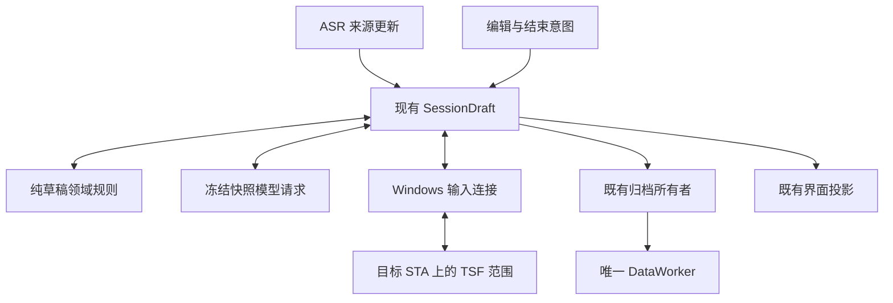

# 持续草稿与编辑接管

本文件记录 `sayweave-revisable-draft-v01` 的分支契约。主线合入和实际 Codex 验收分别结算；模型输出正确不代表目标宿主输入已经通过。

现有 SessionDraft 仍是唯一串行业务调度者。`processing/draft.rs` 只维护逻辑块、来源快照、内容版本、可见版本、容量边界和停止规则，不依赖 Tauri、COM、数据库或供应商。公共来源与归档关联放在 `contracts/draft.rs`，数据层不反向依赖口述或模型模块。

逻辑块、内容快照和原生写入租约是独立身份。ASR 最终片段或停顿不交付块；模型预览替换当前草稿，并保留快照之后的新尾部。来源修订、真实编辑、停止会撤销旧结果资格。同块仅一个生成请求，沿用首次确认文字后的150ms合并窗口；结束复查实际最终覆盖，不把空请求槽当成覆盖证明。

用户编辑先撤销写权限、结束组合，再保留只读范围。原生在原 STA 核验宿主创建身份、上下文、锚点、范围版本、正文和块内选择，在原精确范围创建组合；组合对象、创建前后正文、选择及租约全部匹配才恢复 `Draft`。首次输入与重新接管统一调用组合写入，协议保留的 Apply 同样委托该实现。创建期间同步终止或重入不能发布旧候选；失败清理绑定该次创建的 epoch、上下文和监听 cookie，代次撤销不能遗漏准备资源，也不能清理新所有者。选择位置无法确定映射时，拒绝模型整块替换并保留原文；不搜索全文或猜测偏移。离开范围、Undo/Redo、文档重建和只读变化结束资格。学习观察仍是独立只读能力。

原生字符串与用户语义正文分别保存。TSF 与 UIA 各自两次读回稳定，不能证明共享正文版本：用户输入真实换行后，UIA 可能仍返回旧正文和相同选择位置。因此当前接管只接受完整文本恒等的跨提供者核对，并且原生原始块外指纹和连续锚点必须同时成立；不根据 UIA 折叠换行、收缩范围或重新建立边界指纹。自有写入已有的表示记录继续限定于它所对应的操作和正文版本，不能延伸解释用户编辑后的差异。已识别的原生 Edit/RichEdit 可以采用恒等正文；无法证明表示的富文本保持只读，等待消耗原总期限且不会授予许可。块外明文不进入持久状态或日志，只保留提供者身份、长度和指纹。

首次 Codex 编辑接管仍未完成。已知缺口是编辑后差异字符的来源证明：当前通用接口没有将语义提供者版本与 TSF 文档版本绑定，已有自有写入记录也不足以解释任意用户编辑后的尾部变化。不能以宿主附加换行的形状猜测来源。受控原生宿主通过只证明对应恒等表示；候选尚未交付，实际 Codex 首次、删除后及后续编辑验收仍待完成。

接管结果区分 Ready、AwaitingProof、Invalidated、Uncertain。等待消耗同一准备总期限；不确定写入停止后续正文重发。刷新租约不创建识别轮次，暂停时保留识别连接并封闭音频入口；迟到的连接就绪不能解除暂停。真实用户编辑只建立一次基线，已显示来源按片段身份和水位吸收，来源长度修订不恢复用户删除内容；无法确认部分片段分界时拒绝消费。块交付同样保存来源水位，不能把旧来源作为新尾部。

正文未变化的许可刷新保留原 ASR 来源和已确认预览；只有真实正文编辑才推进吸收水位。预览始终保留来源身份，不能折成用户基线。当前单一插入段无法证明纯光标移位后的来源位置时，结束该块回改资格、保留正文并从新位置继续；不会用伪造编辑基线绕过这一限制。真实块内改字后的新基线仍按核实的光标／选区位置接管。

组合范围与跟踪范围是独立对象。每次仍受授权的组合写入和换行落定完成后，原生从实际组合范围同步跟踪锚点与正文版本，不假定克隆范围会自动扩展。同步准备仍接收用户编辑；实际自身写入期间仅跳过补充跟踪的中间几何检查，原有组合所有权、焦点、撤销及清理保护继续生效。最后再次核验写权限，然后发布请求版本。失效范围不会因同步恢复资格。

较宽的变更通知可通过原生边界证明核实：保留块前、块后的原始锚点，要求它们与当前块及文档边界连续，块外 UTF16 指纹和长度均保持一致。核验读取合计最多64Ki UTF16单元，不保留或上传块外明文；证据不可得、受保护或超预算时沿用严格拒绝。组合写入同步边界时也必须保持原指纹，不能用重新采样把块外变化认作已授权。同步失败保留已确认输入效果，同时结束后续接管资格。

协议10增加 Bind/Read/Acquire/Apply/Release 和针对精确 operation/revision 的 Revoke。排队操作可以撤销；操作开始后以实际回执为准，不能把撤销意图当成未写入。固定代理 ABI1、控制协议1及观察版本2保持。范围、回调和清理都计入核心租约，未确认退役继续阻止不安全输入或切换。

绿色结束复用已覆盖的整理，或在原结束期限内整理最后快照；容量交付后的尾部仍须收尾。期限到后不循环读取被连续编辑赶上的快照。×立即停止后续应用，保留确认显示的正文。清理失败保存已知正文和不确定事实，不能宣称正常交付。

当前块上限2000 Unicode标量，前文只读参考512标量，消息32KiB，最大输出4096 tokens，正文16KiB。编辑基线占用同一块容量。句末、字素和受保护文本决定容量边界；超长不可拆片段保留原文，不发送超预算模型请求。原生容量独立限制，不截断用户正文。

schema10新增块检查点与处理尝试关联；旧 source_refs 数组、提示快照和处理记录保留。编辑器正文使用 editorSnapshot 来源，模型重写不会成为用户学习证据。历史最终正文来自实际确认版本，不拼接每次整块候选。文字整理关闭或不可用时使用 native 模式记录口述结果，不制造模型调用。恢复格式2兼容格式1；处理尝试和检查点补写完成之前不提前封存终态，取消和删除优先。恢复不执行编辑器写入。

内部 `SAYWEAVE_DRAFT_STRATEGY=segmented` 保留 schema10 兼容的旧策略及 faithful-v3 提示；用户界面没有设置项。schema10写入后不能直接交给旧程序读取。回退使用当前构建和既有部署事务，保留用户资料。

定向证据覆盖领域回放、受控供应商请求、旧历史兼容、恢复顺序，以及自有 RichEdit 的真实接管、租约失效、撤销时序和正文读回。普通 EDIT 无法保留合法锚点时，准确拒绝接管并走新位置路径。实际 Codex 手动修改后继续口述须另行核对。
