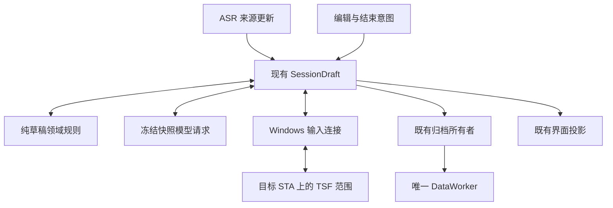

# 持续草稿与编辑接管

本文件记录 `sayweave-revisable-draft-v01` 的分支契约。主线合入和实际 Codex 验收分别结算；模型输出正确不代表目标宿主输入已经通过。

现有 SessionDraft 仍是唯一串行业务调度者。`processing/draft.rs` 只维护逻辑块、来源快照、内容版本、可见版本、容量边界和停止规则，不依赖 Tauri、COM、数据库或供应商。公共来源与归档关联放在 `contracts/draft.rs`，数据层不反向依赖口述或模型模块。

逻辑块、内容快照和原生写入租约是独立身份。ASR 最终片段或停顿不交付块；模型预览替换当前草稿，并保留快照之后的新尾部。来源修订、真实编辑、停止会撤销旧结果资格。同块仅一个生成请求，沿用首次确认文字后的150ms合并窗口；结束复查实际最终覆盖，不把空请求槽当成覆盖证明。

用户编辑先撤销写权限、结束组合，再保留只读范围。原生在原 STA 核验宿主创建身份、上下文、锚点、范围版本、正文和块内选择，才授予新租约。Apply 在实际写锁中再次比较。选择位置无法确定映射时，拒绝模型整块替换并保留原文；不搜索全文或猜测偏移。离开范围、Undo/Redo、文档重建和只读变化结束资格。学习观察仍是独立只读能力。

协议10增加 Bind/Read/Acquire/Apply/Release 和针对精确 operation/revision 的 Revoke。排队操作可以撤销；操作开始后以实际回执为准，不能把撤销意图当成未写入。固定代理 ABI1、控制协议1及观察版本2保持。范围、回调和清理都计入核心租约，未确认退役继续阻止不安全输入或切换。

绿色结束复用已覆盖的整理，或在原结束期限内整理最后快照；容量交付后的尾部仍须收尾。期限到后不循环读取被连续编辑赶上的快照。×立即停止后续应用，保留确认显示的正文。清理失败保存已知正文和不确定事实，不能宣称正常交付。

当前块上限2000 Unicode标量，前文只读参考512标量，消息32KiB，最大输出4096 tokens，正文16KiB。编辑基线占用同一块容量。句末、字素和受保护文本决定容量边界；超长不可拆片段保留原文，不发送超预算模型请求。原生容量独立限制，不截断用户正文。

schema10新增块检查点与处理尝试关联；旧 source_refs 数组、提示快照和处理记录保留。编辑器正文使用 editorSnapshot 来源，模型重写不会成为用户学习证据。历史最终正文来自实际确认版本，不拼接每次整块候选。文字整理关闭或不可用时使用 native 模式记录口述结果，不制造模型调用。恢复格式2兼容格式1；处理尝试和检查点补写完成之前不提前封存终态，取消和删除优先。恢复不执行编辑器写入。

内部 `SAYWEAVE_DRAFT_STRATEGY=segmented` 保留 schema10 兼容的旧策略及 faithful-v3 提示；用户界面没有设置项。schema10写入后不能直接交给旧程序读取。回退使用当前构建和既有部署事务，保留用户资料。

定向证据覆盖领域回放、受控供应商请求、旧历史兼容、恢复顺序，以及自有 RichEdit 的真实接管、租约失效、撤销时序和正文读回。普通 EDIT 无法保留合法锚点时，准确拒绝接管并走新位置路径。实际 Codex 手动修改后继续口述须另行核对。
